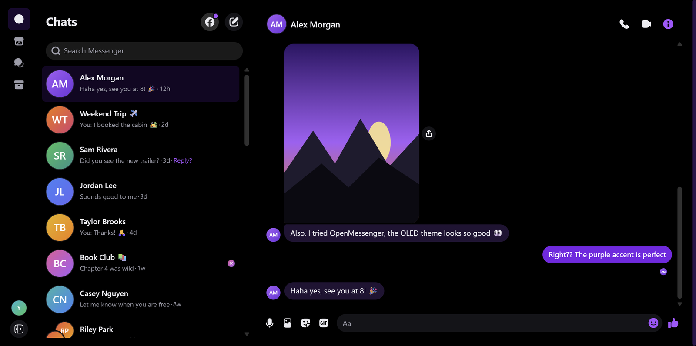
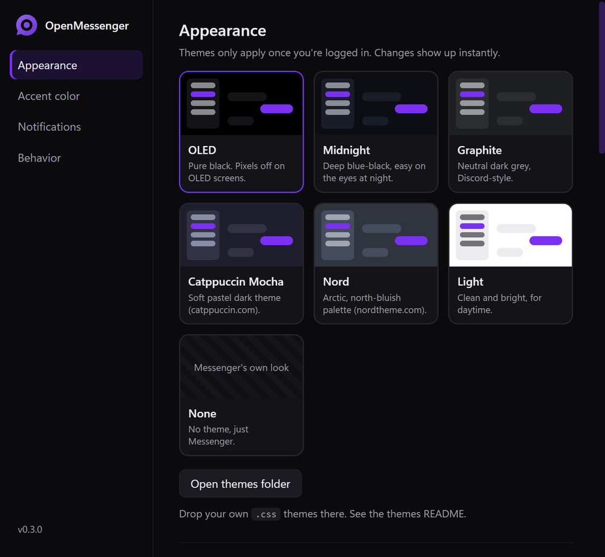
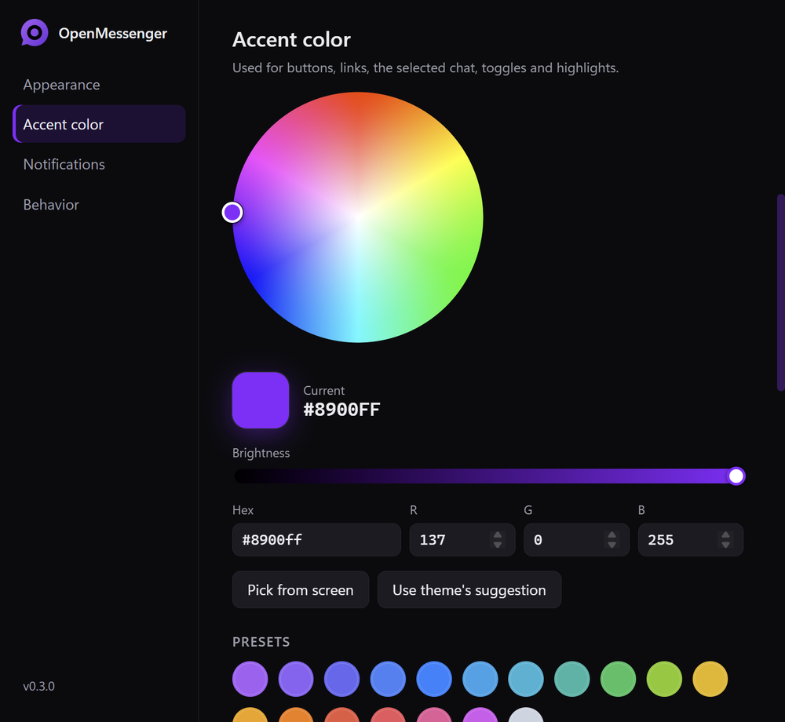
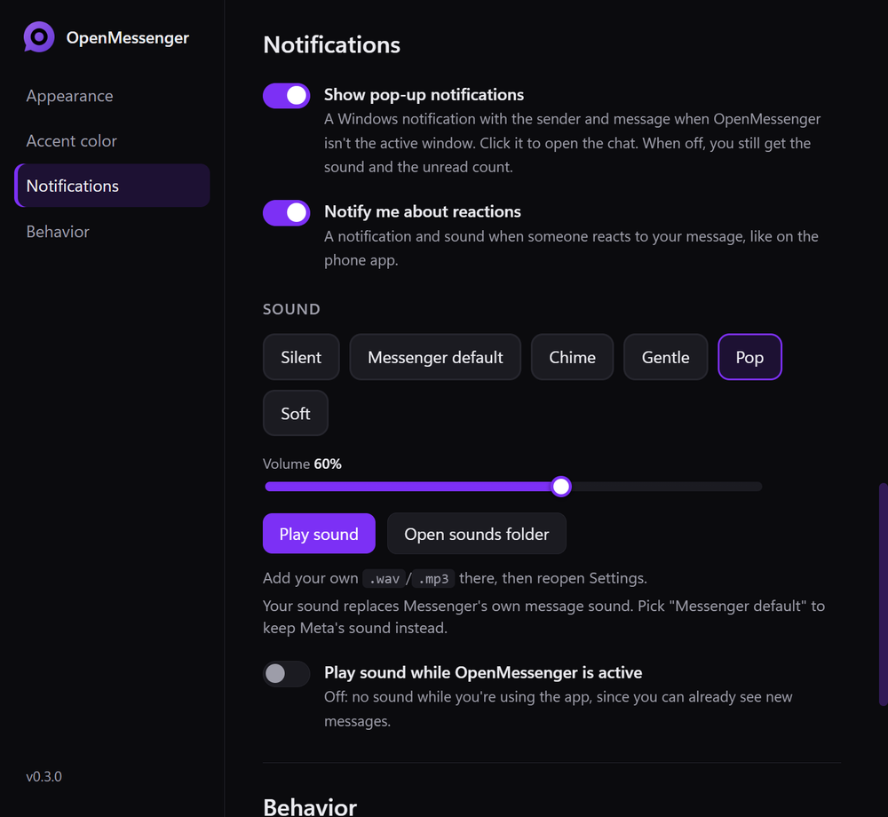

<p align="center"></p>

<h1 align="center">OpenMessenger</h1>

<p align="center">A portable desktop app for Facebook Messenger, with themes, any accent color and your own notification sounds.</p>

---

Meta discontinued the official Messenger desktop app. OpenMessenger gives you a real desktop
app again: its own window, taskbar badge, tray icon and native notifications, wrapped around
Messenger's own web client (messenger.com). Because it runs Messenger's own client, you get
Messenger's features, calls included, the same as in a browser.

<p align="center">
  
</p>

<table align="center">
  <tr>
    <td align="center"><a href="docs/screenshots/settings-appearance.png"></a><br><sub>Themes</sub></td>
    <td align="center"><a href="docs/screenshots/settings-accent.png"></a><br><sub>Accent color</sub></td>
    <td align="center"><a href="docs/screenshots/settings-notifications.png"></a><br><sub>Notifications</sub></td>
  </tr>
</table>

<p align="center"><sub>Screenshots use made-up names and messages.</sub></p>

> [!IMPORTANT]
> **Not affiliated with Meta.** OpenMessenger is an independent, unofficial project. It is not
> affiliated with, endorsed by, sponsored by or connected to Meta Platforms, Inc. in any way.
> "Messenger" and "Facebook" are trademarks of Meta Platforms, Inc., used here only to describe
> what the app works with. Use it at your own risk and in line with Meta's terms of service.

> [!NOTE]
> **This project was built with AI.** I wanted a proper Messenger desktop app for myself, so an AI
> coding assistant wrote the code while I tested it and steered the design. I don't claim to have
> written it by hand. It's shared in case it's useful to anyone else. Issues and pull requests are
> welcome, but please read the code before you trust it with your account, as you would with any
> project.

## Features

- **Messenger's own client.** Chats, groups, reactions, voice notes, stickers and calls all come
  from messenger.com itself.
- **Themes.** OLED, Midnight, Graphite, Catppuccin Mocha, Nord and Light, or Messenger's own look.
- **Any accent color.** Color wheel, brightness slider, hex/RGB input, 18 presets, or pick a color
  from anywhere on screen. It works with every theme, and you can optionally recolor every chat's
  message bubbles with it.
- **Notification sounds.** Four gentle built-in sounds, your own, or Messenger's default.
  Your choice replaces Messenger's own message sound. Adjustable volume.
- **Desktop integration.** Windows notifications with the sender, message and profile picture
  whenever OpenMessenger isn't the active window (click one to open that chat), optional
  notifications when someone reacts to your message, an unread count on the taskbar icon, a tray
  icon, close-to-tray, and a **Settings** entry when you right-click the taskbar icon.
- **Self-contained.** Installer or portable zip, the app and all its data live in one folder.
  Nothing is spread around your system (see *Uninstalling*).
- **Optional start with Windows.** Off by default, with an option to start minimized to the tray.
- **Your own CSS themes.** They reload live while you edit them.
- **Screen-share picker.** When you share your screen in a call, pick a screen or window from live
  previews, with an option to include your PC's audio.
- Right-click menu with spell-check suggestions, copy/save image, and open-link-in-browser.
  External links open in your normal browser.

## Install (Windows)

**Installer (recommended):**

1. Download `OpenMessenger-Setup-x.y.z.exe` from [Releases](../../releases) and run it.
2. Choose where to install it. The default is your user folder, which doesn't need admin rights.
   Avoid *Program Files*: it's write-protected, so OpenMessenger couldn't keep its data there.
3. Log in to Messenger. Desktop and Start Menu shortcuts are created for you.

**Portable zip:** download the Windows `.zip`, extract it to a folder of your choice, and run
`OpenMessenger.exe`. Extract it first: running it from inside the zip loses your login.

> [!NOTE]
> The app isn't code-signed, so Windows SmartScreen may say
> *"Windows protected your PC"* the first time. Click **More info → Run anyway**.

Either way, the app and **all its data** (login, settings, themes and sounds) live together in one
folder. The data is in its `data` subfolder.

**Updating:** run the new installer. It keeps your `data` folder. With the zip, quit OpenMessenger
(tray icon → Quit) and extract the new version over the old folder.

**Moving from the zip to the installer:** install, then **quit OpenMessenger completely** (tray
icon → Quit, including the copy the installer opens at the end). Then copy your old `data` folder
into the new install folder, replacing the new one. If OpenMessenger is still running, it keeps
its own empty login and you'll have to log in again.

**Uninstalling:** with the installer, use *Settings → Apps → OpenMessenger*. It asks whether to
delete your data too, and removes OpenMessenger's registry entries. With the zip, turn off
*Start with Windows* if you enabled it, quit the app, and delete the folder.

Outside its folder, OpenMessenger only writes a few small entries under your user account:

- `HKCU\Software\Classes\AppUserModelId\io.github.cinnamonshaey.openmessenger` gives the app's
  name and icon to Windows, which needs it to show notifications.
- The *Start with Windows* entry, only if you turned that on. Turning it off removes it.
- With the installer: the Settings → Apps entry and the shortcuts.

The uninstaller removes all of these. Windows also keeps its own small records, like your
notification preferences for the app.

### macOS and Linux (experimental)

The release workflow also builds a macOS `.zip` and Linux `AppImage`/`tar.gz`, but **these have
never been tested**. On those systems the app stores its data in the normal per-user folder
(`~/Library/Application Support/OpenMessenger` or `~/.config/OpenMessenger`) instead of next to
the app. Feedback and fixes are welcome.

## Settings

Open **Settings** with `Ctrl+,`, from the tray icon menu, by right-clicking the taskbar icon, or
from the menu bar (press `Alt`):

| Section | What's there |
| --- | --- |
| Appearance | Theme cards with a preview, plus a button to open the themes folder |
| Accent color | Color wheel, brightness, hex/RGB, presets, pick-from-screen, "use theme's suggestion", recolor chats |
| Notifications | Pop-up notifications on/off, reaction notifications on/off, sound while the app is active on/off, pick a sound (click to hear it), volume, play button, open the sounds folder |
| Behavior | Close button hides to tray, start with Windows, start minimized, desktop shortcut, open the data folder |

Other shortcuts: zoom with `Ctrl + scroll wheel` or `Ctrl +` / `Ctrl -` (`Ctrl 0` resets, and
the zoom level is remembered), reload the theme with `Ctrl+Shift+R`,
developer tools with `Ctrl+Shift+I`.

> **Moved the app folder?** Turn *Start with Windows* off and on again so it points to the new
> location.

## Custom themes and sounds

- **Themes:** Settings → **Open themes folder** (`data\themes`), add a `.css` file, and reopen
  Settings. A theme is a small color palette on top of a shared base, so a basic one is about 10
  lines. See [themes/README.md](themes/README.md).
- **Sounds:** Settings → **Open sounds folder** (`data\sounds`), add `.wav`, `.mp3`, `.ogg`, `.m4a`
  or `.flac` files, and reopen Settings. Short sounds (under 1 second) work best.

## Known limitations

- **Calls:** the app's parts (microphone, speakers, the screen-share picker and system audio) are
  tested, but a full two-way call hasn't been tested yet. Calls run on Messenger's own code, the
  same as in Chrome.
- **Reaction notifications** only recognize Messenger's English wording for now.
- **Notifications are built from Messenger's chat list.** If Meta redesigns messenger.com,
  notifications or themes may break until OpenMessenger is updated.
- **macOS and Linux** builds are untested (see above).

## Privacy and security

- **Your password is never stored.** Like a browser, the app keeps Messenger's login session
  cookie. In release builds that cookie is **encrypted** with your Windows account (DPAPI), so a
  copied `data` folder can't be used to log in on another PC or user account.
- **OpenMessenger adds no telemetry.** The app itself collects nothing and sends nothing anywhere.
  It only loads Meta's own Messenger/Facebook pages, and links to other sites open in your normal
  browser.
- **Meta's own tracking is untouched.** Messenger is Meta's web client running as-is, so whatever
  data collection Meta does on messenger.com in a browser happens here too. OpenMessenger doesn't
  block or change it.
- **Locked-down window.** Messenger runs sandboxed and context-isolated, with no access to Node.js
  or your files. Camera, microphone, notification and screen-share permissions are granted only to
  Messenger/Facebook pages.
- **Hardened executable.** Electron's Node.js inspector and run-as-Node switches are disabled, and
  the app's code is integrity-checked at startup.

## How it works

OpenMessenger loads `messenger.com` in a Chromium window and reports a standard Chrome user agent,
so Meta serves its normal web client. A small preload script adds the desktop parts:

- **Notifications.** In a browser, messenger.com shows desktop notifications through web push,
  which this kind of app doesn't support. So when a new message arrives while the window isn't
  active, OpenMessenger reads the sender, preview and picture from the chat list and shows the
  Windows notification itself.
- **Reactions.** Messenger plays no sound for reactions, so the app watches the chat list for
  "Reacted … to your message" previews.
- **Sound.** Messenger's short message sound is swapped for yours. Call ringtones are left alone.
  Any notification Messenger creates itself is made silent so you don't hear two sounds.

Screen sharing is Messenger's own feature. Chrome has a built-in "what do you want to share?"
picker, but Electron doesn't, so OpenMessenger provides that one window.

Themes are injected as stylesheets that override Messenger's own CSS variables. The accent color
is generated as a separate layer on top, including CSS-filter values for the icons Meta tints with
filters rather than colors.

## Development

Requirements: [Node.js](https://nodejs.org) 20+ and Git.

```bash
git clone https://github.com/CinnamonShaey/OpenMessenger.git
cd OpenMessenger
npm install
npm start          # run from source (data goes to ./data, git-ignored)
npm run dev        # same, with Chrome DevTools Protocol on port 9333 (see scripts/cdp.js)
npm run dist       # build into ./dist (Windows: portable zip + dist/win-unpacked)
npm run assets     # regenerate icon, badges and sounds (needs uv)
```

> [!WARNING]
> Running from source uses plain Electron, which **doesn't encrypt cookies**. Your login in
> `./data` is stored unencrypted. Use `npm run dist` builds for everyday use, and delete `./data`
> when you're done developing.

Layout:

```
src/main.js             app window, tray, menus, permissions, settings window, screen-share picker,
                        start-with-Windows, notification registration
src/preload.js          runs in the Messenger page: notifications, reactions, sound replacement
src/theme.js            theme loading (@extends chains) + generated accent layer
src/color.js            color math + CSS-filter solver
src/settings-ui/        the Settings and screen-share picker windows (served from a private om:// scheme)
src/paths.js            where data is stored (portable on Windows)
src/settings.js         data/settings.json
themes/                 built-in themes (see themes/README.md)
assets/                 icon, tray icon, unread badges, built-in sounds
scripts/make-assets.py  generates everything in assets/ (no third-party artwork or audio)
scripts/cdp.js          poke at a running `npm run dev` build: evaluate JS, take screenshots
docs/screenshots/       images used in this README
```

### Publishing a release

For maintainers, including anyone publishing releases from their own fork. Bump `version` in
`package.json`, commit, then push a matching tag:

```bash
git tag vX.Y.Z
git push --tags
```

GitHub Actions builds Windows, macOS and Linux packages and attaches them to a **draft**
release. Check it, then publish it on GitHub.

## License

Copyright (C) 2026 CinnamonShaey

OpenMessenger is free and open-source software, licensed under the
[GNU General Public License v3.0 or later](LICENSE). You can use, study, change and share it,
including your own forks. If you distribute a modified version, it must also be released under
the GPL with its source code available, so it stays open source.

The bundled icon and sounds are generated by `scripts/make-assets.py` and fall under the same
license. Electron and the other dependencies keep their own (permissive) licenses.
